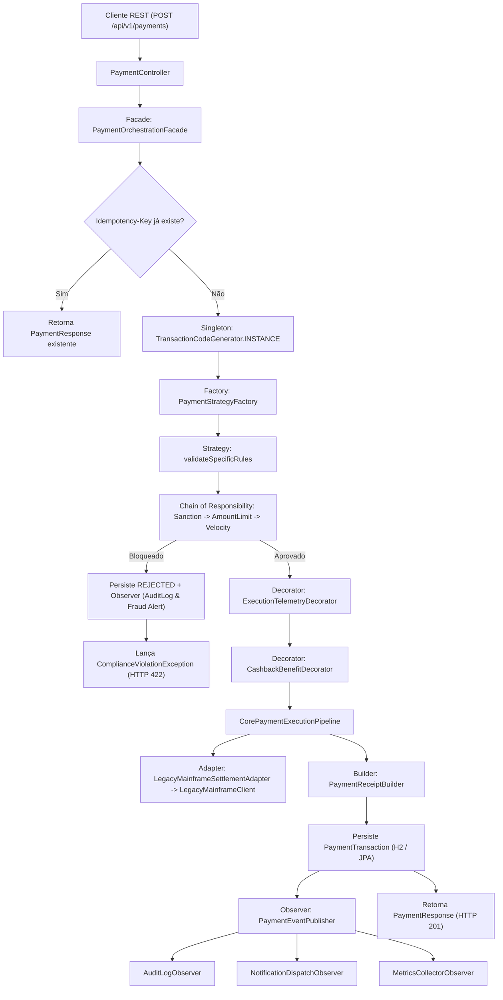

# Design Patterns Payment Hub

> Solução desenvolvida para o "Desafio de Projeto: Explorando Padrões de Projetos na Prática com Java e Spring Boot", integrante do "Bootcamp Java & Spring Boot promovido pelo Itaú em parceria com a Digital Innovation One (DIO)".

Este projeto implementa um hub modular de processamento de pagamentos (`PIX`, `CREDIT_CARD` e `BOLETO`) em Spring Boot 3.5 + Java 21+, orquestrando 9 padrões de projeto clássicos (GoF) distribuídos entre as categorias Criacionais, Estruturais e Comportamentais, combinados com Java moderno (`record`s imutáveis, `BigDecimal` com arredondamento `HALF_EVEN`, `EnumMap`, Bean Validation, Spring Data JPA/H2 e OpenAPI/Swagger).

---

## Sumário

1. [Arquitetura Modular](#arquitetura-modular)
2. [Fluxo Ponta a Ponta (Mermaid)](#fluxo-ponta-a-ponta)
3. [Catálogo dos 9 Padrões GoF Implementados](#catálogo-dos-9-padrões-gof-implementados)
4. [Padrões Nativos do Spring Framework Aplicados](#padrões-nativos-do-spring-framework-aplicados)
5. [Regras de Negócio](#regras-de-negócio)
6. [Endpoints da API REST](#endpoints-da-api-rest)
7. [Exemplos de Uso (`curl`)](#exemplos-de-uso-curl)
8. [Como Compilar, Testar e Executar](#como-compilar-testar-e-executar)

---

## Arquitetura Modular

```text
springFramework/design-patterns-payment-hub
├── mvnw / mvnw.cmd                      # Maven Wrapper oficial (Apache Maven 3.9.9)
├── pom.xml                              # Spring Boot 3.5.16, Java 21+, H2, JPA, Validation, SpringDoc 2.10.0
└── src
    ├── main
    │   ├── java/io/github/davigdomingues/paymenthub
    │   │   ├── PaymentHubApplication.java
    │   │   ├── config/
    │   │   │   ├── ComplianceProperties.java # @ConfigurationProperties imutável (record)
    │   │   │   ├── OpenApiConfig.java # Metadados OpenAPI 3 / Swagger
    │   │   │   └── PaymentPatternWiringConfig.java # Montagem explícita da Chain e Decorators
    │   │   ├── controller/
    │   │   │   ├── MetricsController.java # GET /api/v1/metrics/summary
    │   │   │   └── PaymentController.java # Endpoints /api/v1/payments/*
    │   │   ├── domain/
    │   │   │   ├── entity/ # PaymentTransaction, PaymentAuditLog, NotificationLog
    │   │   │   ├── enums/ # PaymentMethod, PaymentStatus, CustomerTier, RiskLevel
    │   │   │   └── model/ # Records imutáveis (PaymentContext, RiskAssessment, etc.)
    │   │   ├── dto/
    │   │   │   ├── request/ # CreatePaymentRequest (Bean Validation)
    │   │   │   └── response/ # PaymentResponse, Simulation, Audit, Notification, Metrics, ApiError
    │   │   ├── exception/ # Exceções de domínio + GlobalExceptionHandler (@RestControllerAdvice)
    │   │   ├── pattern/
    │   │   │   ├── singleton/ # TransactionCodeGenerator (enum INSTANCE)
    │   │   │   ├── builder/ # PaymentReceiptBuilder
    │   │   │   ├── factory/ # PaymentStrategyFactory
    │   │   │   ├── strategy/ # PaymentStrategy + PIX / CreditCard / Boleto
    │   │   │   ├── chain/ # ComplianceValidationHandler + 3 elos antifraude
    │   │   │   ├── adapter/ # ExternalSettlementPort + LegacyMainframeClient / Adapter
    │   │   │   ├── decorator/ # PaymentExecutionPipeline + Core + Cashback + Telemetry
    │   │   │   ├── observer/ # PaymentEventPublisher + AuditLog / Notification / Metrics
    │   │   │   └── facade/ # PaymentOrchestrationFacade
    │   │   └── repository/ # Repositórios Spring Data JPA
    │   └── resources/application.yml
    └── test/java/io/github/davigdomingues/paymenthub
        ├── controller/ # Testes de integração ponta a ponta (@SpringBootTest + MockMvc)
        ├── facade/ # Testes unitários da orquestração
        └── pattern/ # Testes unitários dedicados para cada padrão GoF
```

---

## Fluxo Ponta a Ponta



---

## Catálogo dos 9 Padrões GoF Implementados

| Categoria | Padrão GoF | Classes Principais | Papel na Arquitetura |
| :--- | :--- | :--- | :--- |
| Criacional | Singleton | `TransactionCodeGenerator` (`enum INSTANCE`) | Garante instância única thread-safe e imune à reflexão para geração sequencial atômica de códigos `TXN-YYYYMMDD-NNNNNN`. |
| Criacional | Builder | `PaymentReceiptBuilder` | Constrói `PaymentExecutionResult` imutável com validação de invariantes e suporte a `from(existing)` para enriquecimento em decorators. |
| Criacional | Factory Method / Registry | `PaymentStrategyFactory` | Injeta automaticamente todos os beans `PaymentStrategy` em um `EnumMap` e resolve a estratégia correta sem `if/else` acoplados. |
| Comportamental | Strategy | `PaymentStrategy`, `PixPaymentStrategy`, `CreditCardPaymentStrategy`, `BoletoPaymentStrategy` | Encapsula regras de validação, cálculo tarifário, status inicial e janela de compensação de cada meio de pagamento. |
| Comportamental | Chain of Responsibility | `ComplianceValidationHandler`, `AccountSanctionValidationHandler`, `AmountLimitValidationHandler`, `VelocityRiskValidationHandler` | Executa checagens encadeadas de sanção, autotransferência, limites por valor/modalidade e velocidade recente de transações. |
| Estrutural | Adapter | `ExternalSettlementPort`, `LegacyMainframeSettlementAdapter`, `LegacyMainframeClient` | Traduz requisições modernas de domínio (`BigDecimal`, enums) para frames posicionais delimitados por pipe (`\|`) com centavos exigidos pelo mainframe legado. |
| Estrutural | Decorator | `PaymentExecutionPipeline`, `CorePaymentExecutionPipeline`, `CashbackBenefitDecorator`, `ExecutionTelemetryDecorator` | Empilha cálculo de cashback e medição de latência ao redor do núcleo de liquidação sem alterar o componente base. |
| Comportamental | Observer | `PaymentEventPublisher`, `PaymentEventObserver`, `AuditLogObserver`, `NotificationDispatchObserver`, `MetricsCollectorObserver` | Propaga eventos de pagamento, rejeição e estorno para auditoria, notificações multicanal e métricas em tempo real, isolando falhas individuais. |
| Estrutural | Facade | `PaymentOrchestrationFacade` | Oculta toda a complexidade dos 8 padrões internos atrás de uma interface de serviço coesa para processamento, simulação, estorno e consultas. |

---

## Padrões Nativos do Spring Framework Aplicados

Além dos padrões GoF implementados explicitamente no pacote `pattern/`, a solução aproveita os padrões arquiteturais idiomáticos do ecossistema Spring:

- **Singleton / IoC Container & Dependency Injection:** Beans `@Service`, `@Component` e `@Configuration` gerenciados pelo contêiner Spring com injeção exclusivamente via construtor.
- **Proxy / AOP (`@Transactional`, `@RestControllerAdvice`):** Controle declarativo de transações com `noRollbackFor = ComplianceViolationException.class` (para preservar registros de rejeição e alertas antifraude) e tratamento centralizado de exceções REST.
- **Template Method / Repository (`JpaRepository`):** Abstração declarativa de persistência e queries derivadas sobre H2.
- **Front Controller (`DispatcherServlet` + `@RestController`):** Roteamento HTTP, desserialização JSON para `record`s e validação declarativa via Jakarta Bean Validation.

---

## Regras de Negócio

### Tarifas (`Strategy`)

| Meio de Pagamento | Regras de Validação | Regra de Tarifa | Status Inicial |
| :--- | :--- | :--- | :--- |
| PIX | `pixKey` obrigatória; `installments == 1` | Isento para `VIP` ou valores `<= R$ 5.000,00`; acima disso `0,25%` com teto de `R$ 25,00` | `APPROVED` |
| CREDIT_CARD | `installments` entre `1` e `12` | Base `2,49% + 0,50%` por parcela extra; desconto de `0,50%` (`PREMIUM`) ou `1,00%` (`VIP`); piso `0,99%` | `APPROVED` |
| BOLETO | `installments == 1`; valor `>= R$ 10,00` | Tarifa fixa: `R$ 3,50` (`STANDARD`), `R$ 1,75` (`PREMIUM`), `R$ 0,00` (`VIP`) | `PENDING_SETTLEMENT` |

### Cashback (`CashbackBenefitDecorator`)

- **VIP:** `2,0%` sobre o valor bruto, limitado ao teto de `R$ 100,00`.
- **PREMIUM:** `1,0%` quando pago via `PIX` ou para valores `>= R$ 200,00`, limitado ao teto de `R$ 50,00`.
- **STANDARD:** `R$ 0,00`.

### Compliance (`Chain of Responsibility`)

1. **Sanções & Autotransferência:** Bloqueia documentos sancionados (`00000000000`, `99999999999`) ou transações onde `payerDocument == payeeDocument`.
2. **Limites de Valor:** Bloqueia valores acima de `R$ 100.000,00` (global) ou `R$ 50.000,00` (`BOLETO`); adiciona `+35` pontos (`HIGH_VALUE_TRANSACTION`) acima de `R$ 20.000,00`.
3. **Velocidade (Janela de 5 minutos):** `>= 3` transações recentes do mesmo pagador adicionam `+30` pontos (`ELEVATED_VELOCITY`); `>= 5` bloqueiam (`VELOCITY_LIMIT_EXCEEDED`).

---

## Endpoints da API REST

| Método | Rota | Descrição | Códigos HTTP |
| :--- | :--- | :--- | :--- |
| `POST` | `/api/v1/payments` | Processa um pagamento (suporta `idempotencyKey`) | `201`, `400`, `422` |
| `POST` | `/api/v1/payments/simulate` | Simula tarifas, cashback e risco sem persistir | `200`, `400`, `422` |
| `GET` | `/api/v1/payments` | Lista transações (filtros opcionais `method` e `status`) | `200`, `400` |
| `GET` | `/api/v1/payments/{transactionCode}` | Busca detalhes de uma transação pelo código | `200`, `404` |
| `POST` | `/api/v1/payments/{transactionCode}/refund` | Solicita estorno via Adapter legado | `200`, `404`, `422` |
| `GET` | `/api/v1/payments/{transactionCode}/audit` | Retorna trilha cronológica de auditoria | `200`, `404` |
| `GET` | `/api/v1/payments/{transactionCode}/notifications` | Retorna notificações despachadas | `200`, `404` |
| `GET` | `/api/v1/metrics/summary` | Exibe métricas agregadas pelo Observer | `200` |

---

## Exemplos de Uso (`curl`)

### 1. Processar PIX VIP (com cashback e isenção de tarifa)

```bash
curl -X POST http://localhost:8080/api/v1/payments \
  -H "Content-Type: application/json" \
  -d '{
    "payerDocument": "11122233344",
    "payeeDocument": "99988877766",
    "amount": 1000.00,
    "paymentMethod": "PIX",
    "customerTier": "VIP",
    "pixKey": "vip@pagamento.com.br",
    "idempotencyKey": "pix-demo-001",
    "description": "Pagamento instantâneo VIP"
  }'
```

### 2. Processar Cartão de Crédito parcelado em 6x

```bash
curl -X POST http://localhost:8080/api/v1/payments \
  -H "Content-Type: application/json" \
  -d '{
    "payerDocument": "22233344455",
    "payeeDocument": "99988877766",
    "amount": 1200.00,
    "paymentMethod": "CREDIT_CARD",
    "customerTier": "PREMIUM",
    "installments": 6,
    "description": "Compra parcelada em 6x"
  }'
```

### 3. Emitir Boleto Bancário

```bash
curl -X POST http://localhost:8080/api/v1/payments \
  -H "Content-Type: application/json" \
  -d '{
    "payerDocument": "33344455566",
    "payeeDocument": "99988877766",
    "amount": 450.00,
    "paymentMethod": "BOLETO",
    "customerTier": "STANDARD",
    "description": "Liquidação de fatura"
  }'
```

### 4. Simular pagamento (dry-run sem persistência)

```bash
curl -X POST http://localhost:8080/api/v1/payments/simulate \
  -H "Content-Type: application/json" \
  -d '{
    "payerDocument": "44455566677",
    "payeeDocument": "99988877766",
    "amount": 25000.00,
    "paymentMethod": "PIX",
    "customerTier": "VIP",
    "pixKey": "simulacao@pagamento.com.br"
  }'
```

### 5. Estornar, auditar e consultar métricas

```bash
# Estorno
curl -X POST http://localhost:8080/api/v1/payments/TXN-20261119-000001/refund

# Trilha de auditoria
curl http://localhost:8080/api/v1/payments/TXN-20261119-000001/audit

# Notificações emitidas
curl http://localhost:8080/api/v1/payments/TXN-20261119-000001/notifications

# Métricas consolidadas
curl http://localhost:8080/api/v1/metrics/summary
```

---

## Como Compilar, Testar e Executar

> Pré-requisito: JDK 21 ou superior instalado (testado em JDK 25). Não é necessário instalar o Maven globalmente pois o projeto inclui o Maven Wrapper (`mvnw` / `mvnw.cmd`).

### Windows (PowerShell)

```powershell
cd springFramework\design-patterns-payment-hub

# Executar toda a suíte de testes unitários e de integração
.\mvnw.cmd test

# Empacotar e verificar build completo
.\mvnw.cmd clean verify

# Iniciar a aplicação
.\mvnw.cmd spring-boot:run
```

### Linux / macOS

```bash
cd springFramework/design-patterns-payment-hub
./mvnw test
./mvnw spring-boot:run
```

### Ferramentas Interativas (com a aplicação em execução)

- **Swagger UI:** <http://localhost:8080/swagger-ui.html>
- **OpenAPI JSON:** <http://localhost:8080/v3/api-docs>
- **H2 Console:** <http://localhost:8080/h2-console> (JDBC URL: `jdbc:h2:mem:paymenthubdb`, Usuário: `sa`, Senha em branco)
